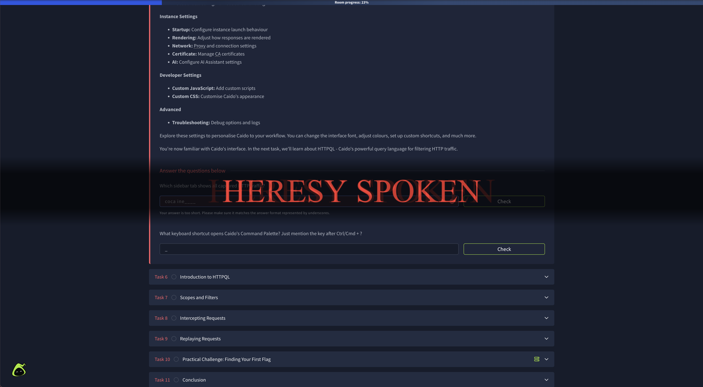

# Elden Ring Hacker Extension

Enhance your Hacker learning experience with Elden Ring–inspired notifications and achievements.

Supports:
* Hackthebox Labs (machines, challenges, sherlocks)
* Hackthebox Academy
* Tryhackme



## Installation

1. Clone this repository
2. Install dependencies:

   ```bash
   bun install
   ```
3. Build the extension and generate the Elden Ring notification images and EH icons:

   ```bash
   bun run build
   ```
The generated notification images are written to `dist/banners`, and the generated EH icons replace the copied icons in `dist/assets`.

## Loading the Extension

1. Open Chrome and navigate to `chrome://extensions/`
2. Enable **Developer mode** (top-right toggle)
3. Click **Load unpacked**
4. Select the `dist` directory from this project

## Features

* Elden Ring–styled notifications for submissions
* Immersive, game-inspired UI elements

## Contributing

Send a PR with new hacker websites, routes, notification names/sounds.

## Credits

* [Original Elden Ring Leetcode repository](https://github.com/Indra55/Elden-ring-leetcode-extension)
* [Elden Ring style image generator](https://github.com/Sibert-Aerts/sibert-aerts.github.io/tree/master/new-area/image-creator)
* Code written by gpt-6-luna:medium
